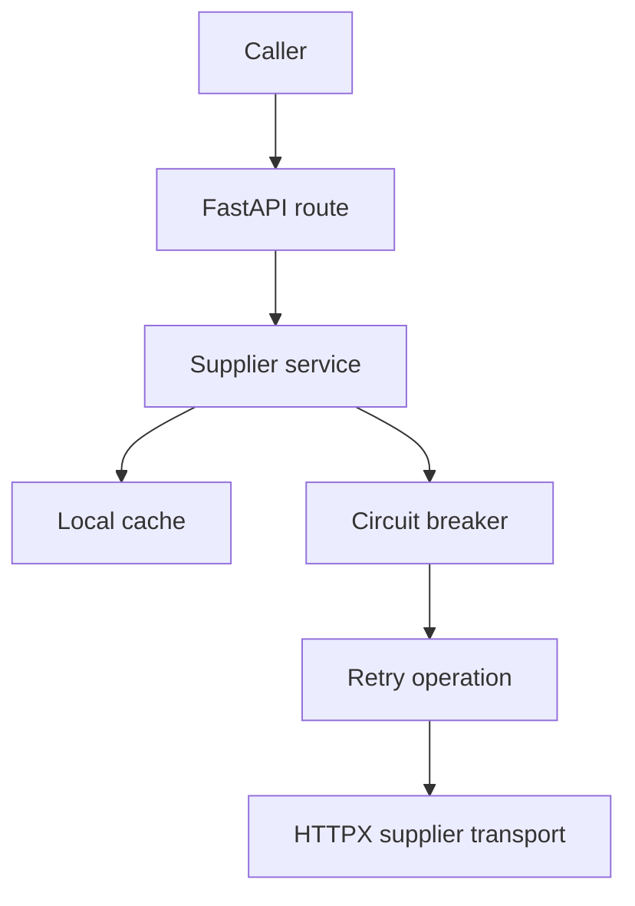

# Building a resilient third-party API client

A workshop hires out tools. Its API asks a supplier for availability. Your task is to keep this integration predictable when the supplier slows down, fails or sends unusable data. You will make changes to one working application and verify each change before continuing.

**Environment:** Python 3.14, FastAPI, HTTPX and GitHub Codespaces.  
**Core work:** 15-minute orientation and 125 minutes of implementation and verification.  
**Homework:** a separate 60-minute Movie Guessing Game starter in this repository.  
**Optional:** 30–45 minutes for Redis. No TMDB account or Docker is needed for the core work.

## Learning objectives

- Select suitable resilience controls and explain their limitations.
- Implement bounded retries, a package circuit breaker and controlled fallback.
- Verify upstream failures using deterministic tests and safe correlated logs.
- Preserve API behaviour and access controls when improving an integration.

## Setup and preparation

### GitHub Codespaces

1. Extract the starter ZIP into the **root** of your own empty GitHub repository. Include `.devcontainer`, `.github`, `.gitignore` and `.python-version`; uploading only visible files may omit these. Use Git or VS Code to add the extracted folder contents.
2. On your repository, choose **Code → Codespaces → Create codespace on main**. The supplied configuration derives from the Cloud-Dev-Lab-Template. It uses the lecturer-confirmed Python 3.14 image.
3. Wait for the setup command to finish. It checks Python, creates `.venv`, installs the pinned dependencies and runs baseline tests.
4. In the terminal at the repository root, run:

```bash
python --version
python -m pytest -q
python -m uvicorn app.main:app --host 0.0.0.0 --port 8000
```

Expect Python **3.14.x** and **3 passing baseline tests**. Open forwarded port 8000 and add `/docs`. Keep the port private. In another terminal activate the same environment before running tests.

### Local alternative

With Python 3.14 installed, run `bash tools/setup.sh`, activate `.venv` and use the same commands. You can perform every core exercise offline after dependencies are installed. [Codespace help](README-codespace.md) describes the editor; this README contains the lab-specific setup.

## How the application fits together



The route calls a service. The service checks the cache, then calls the supplier through the resilience controls. The transport simulates an external supplier in memory. Fallback happens in the service **after** the breaker has observed a failed operation. The starter has one attempt and inactive breaker, fallback and event hooks; it already returns controlled errors.

The simulator injects HTTPX exceptions. This verifies error handling, not real network timing. `python tools/timeout_probe.py` provides a separate localhost socket timeout check.

## API contract

See [Endpoints and data shapes](API-CONTRACT.md) for all methods, inputs, responses, status codes and lab controls. Use `drill-01` for the supplied fixture. FastAPI also supplies `/docs` and `/openapi.json`.

## Exercises

| Stage | Time | Work | Check |
|---|---:|---|---|
| [1. Observe failures](exercise-1.md) | 15 min | Orientation and predictions | Baseline tests |
| [2. Timeouts and retries](exercise-2.md) | 40 min | Guided loop and bounded waits | Retry tests |
| [3. Circuit breaker](exercise-3.md) | 30 min | Package configuration and failure counting | Breaker tests |
| [4. Cache-backed fallback](exercise-4.md) | 20 min | Freshness versus retention | Fallback tests |
| [5. Structured logging](exercise-5.md) | 10 min | Safe JSON events | Logging tests |
| [6. Independent investigation](exercise-6.md) | **25 min protected** | Diagnose a rate-limited dependency | Your tests and explanation |
| [7. Redis](exercise-7.md) | 30–45 min optional | Shared cache and cache outage | Redis checks |

★ [Homework: resilient Movie Guessing Game](homework/README.md). All starter code and fixtures are included. You do not need files from another repository.

## Tests and progress

`python -m pytest` runs baseline checks only. Run the named verification file in each exercise as you implement the behaviour; it is expected to fail before that stage. Do not change assertions merely to obtain a pass. Add the completed verification tests to your CI command when ready. The supplied workflow starts with baseline checks so unfinished learning tasks do not make the starter look broken.

Commit useful milestones:

```bash
git status
git add app tests
git commit -m "Implement and verify bounded retries"
git push
```

Stage only intended files. Keep `.env` out of Git. Bring test results and your short decision record to the review session; no additional submission service is required by this lab.

## Support and reference implementations

Each exercise includes hints, success criteria and recovery advice. The complete teaching distribution has `solutions/exercise-1` through `solutions/exercise-7` and `solutions/homework`. These are **possible solutions**, not the only acceptable implementations. The classroom starter export omits them. Your tutor can release the `solutions` branch when useful.

Do not overwrite your work to view a reference. In a distribution containing solutions:

```bash
python tools/checkpoint.py exercise-5 .work/logging-checkpoint
cd .work/logging-checkpoint
python -m pytest tests/verification/test_logging.py -q
```

The destination must be new. A working checkpoint can help you reach the independent task on time; it does not replace your explanation or verification.

This lab is a teaching example: one process, one simulated dependency and a small in-memory cache. The package does not provide a distributed breaker or a single-flight half-open probe lock. Real systems need service budgets, concurrency controls, production access control and operational monitoring appropriate to their context.

AI-authored teaching resource, prepared for lecturer review. Follow your lecturer's instructions for learning support; this notice does not set permissions for assessed work. Never share credentials with AI tools.
