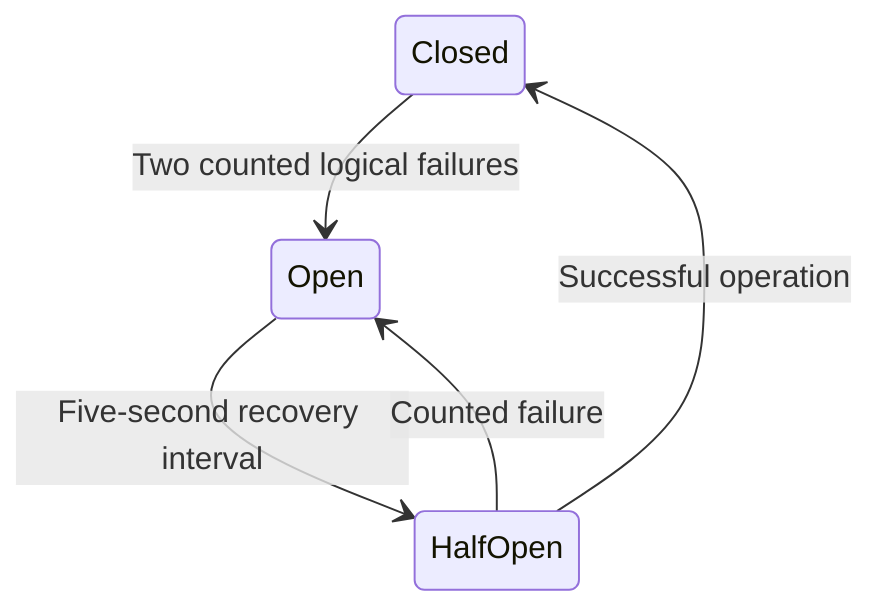

# Exercise 3 — Integrate a circuit-breaker package

Configure a breaker and explain what it counts.

**Time:** 30 minutes. **Work:** individual, compare reasoning with a partner after checking.

## Before you start

Complete Exercise 2. A circuit breaker temporarily rejects dependency calls after enough counted failures. Closed permits calls; open rejects them; after the recovery interval, half-open permits a recovery trial. Successful calls reset the package's consecutive failure count.

This is a single-request teaching model. The package does not itself lock concurrent half-open requests to one probe or share state between processes.

## Guided walkthrough

Read `SupplierService.__init__`. The protected callable wraps `_with_retries`, so one exhausted three-attempt operation counts once. Fallback remains outside the protected operation. Predict the transport-call count when a threshold of two opens the breaker.

## Guided application

In `app/breaker.py`, return `CircuitBreaker(...)`. Use `failure_threshold=2`, `recovery_timeout=5` and `name='supplier'`. Supply an `expected_exception` predicate accepting `(exc_type, exc)`: it is true only for an `UpstreamFailure` with `retryable=True`.

Do not add a fallback function to the decorator. Do not create a new breaker for every request. The service constructs and reuses one instance.

## Supported practice

Run `python -m pytest tests/verification/test_breaker.py -q`. Expect **3 passes**. Two failed logical calls produce six attempts, the next request produces zero additional upstream calls, and advancing the fake clock by five seconds permits recovery. A failed recovery attempt reopens the circuit.

## Required decision

Draw or describe the alternative nesting `retry(breaker(attempt))`. For the same threshold, would individual attempts or exhausted operations be counted? Explain why retries around a breaker could repeatedly hit an already-open circuit. Keep the original nesting in your application.

Inspect the package-specific ignored-error test. Non-counted exceptions **reset** its consecutive failure count; they do not merely leave the count unchanged. Explain the consequence of an upstream 401 between two transient failures.

## Finish and reflect

- Save your code and test output. Explain one prediction that the results confirmed or changed.
- Commit the completed change, then continue to the next exercise from the lab overview.
- If a test fails, read its first failed assertion, inspect the relevant hook and rerun that file. Keep your current work before using a checkpoint in a new directory.

## Support

Hint 1: identify the boundary

Which part is responsible for the behaviour: the HTTP attempt, retry operation, breaker, cache or route? Follow that boundary before editing.

Hint 2: inspect evidence

Compare the expected attempt count, API response and failure category. A successful response alone does not prove the resilience policy worked.

Hint 3: reduce the case

Run a single test with `python -m pytest path/to/test_file.py -x -vv`, replacing the path with this exercise's stated test file. Check the function named in the failure before changing unrelated code.

| Symptom | Check | Recovery |
|---|---|---|
| Import error | Working directory and activated `.venv` | Run from the repository root using `python -m pytest` |
| Unexpected cached success | `/lab/state`, cache age | `POST /lab/reset`, then set the scenario again |
| Breaker rejects a request | Current state and previous failed calls | Reset the lab or wait for the configured recovery interval |
| Edit has no visible effect | Running server | Stop with Ctrl+C and restart the stated Uvicorn command |
| Test expects more behaviour than implemented | Selected verification file | Use only the current and already-completed stage tests |

**Catch-up:** use the tutor-supplied previous checkpoint in a new folder, complete this stage's small change and explain its targeted test. A terminal and the same tests provide an alternative to Postman or Swagger UI.

[Return to the lab overview](README.md)
